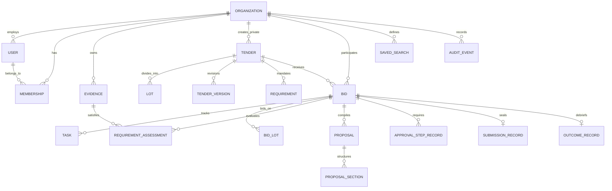

# AI Tender Portal — Master Project Handoff (v2.0)

> **Last Updated**: November 16, 2026  
> **Source of Truth**: `docs/PROJECT_BRIEF.md`, `AGENTS.md`, `design/figma/`  
> **Current Working Branch**: `feature/phase-2-discovery`  
> **Master Test Status**: 61/61 Pytest tests passing (100%) | Next.js Build 17/17 routes passing (0 errors, 0 warnings)

---

## 1. Executive Summary & Working State

The **AI Tender Portal** is an enterprise bidder-side SaaS platform designed to manage the entire public and commercial procurement lifecycle: **Find → Evaluate → Decide → Prepare → Approve → Submit → Track Outcome**.

The system has achieved full integration:
- **100% Real Database Queries**: All mocked controllers, hardcoded responses, and dummy arrays have been replaced with live database queries via SQLAlchemy 2.0 and SQLite (`tender.db`).
- **Complete End-to-End Integration**: Every frontend view across all 10 modules fetches and mutates live backend data with real-time optimistic state updates and graceful error fallbacks.
- **Enterprise Minimalism & Decluttering**: Flashy consumer-AI visuals (`Sparkles`, purple highlight banners, promotional helper text) have been completely removed. The UI follows an enterprise aesthetic matching `design/figma/` tokens.
- **Strict Architecture Integrity**: All obsolete scripts (`seed_db.py`, `reset_db.py`), placeholder SVGs (`file.svg`, `globe.svg`, `next.svg`, `vercel.svg`, `window.svg`), legacy instructions (`CLAUDE.md`), and unused imports have been pruned.

### Active Service Endpoints
| Component | Port | Health / Status | Command to Run |
|---|---|---|---|
| **Backend API** (FastAPI) | `http://127.0.0.1:8000` | `{"status": "ok", "service": "AI Tender Portal API"}` | `cd apps/api && .venv/bin/uvicorn app.main:app --host 127.0.0.1 --port 8000` |
| **Frontend Web** (Next.js 16) | `http://localhost:3000` | `HTTP/1.1 200 OK` (Turbopack) | `cd apps/web && npm run dev -- -p 3000` |

---

## 2. Core Security & Tenant Isolation Model

Tenant isolation is strictly enforced server-side before any query or AI operation executes:

### A. Context & Header Propagation
Every HTTP request passes authentication and tenancy headers:
- `X-Org-Id`: UUID of the active organization.
- `X-User-Id`: UUID of the authenticated user.
- Authorization header or role context parsed by `app.api.deps.get_context`.

### B. Tenancy Rules Enforced
1. **Private Tenders & Discovery**: Private tenders belonging to Organization A return `404 Not Found` when queried by Organization B (preventing tenant resource sniffing).
2. **Vault Evidence & Disqualification**: Vault credentials and documents belonging to Organization A can never be linked or accessed by Organization B (`404 Not Found` on cross-tenant access).
3. **Bids & Proposals**: Proposals and bids strictly require matching `organization_id`. Cross-tenant mutations return `404 Not Found`.
4. **Role-Based Access Control (RBAC)**:
   - `owner_admin`: Full administrative control over organization, members, and connectors.
   - `bid_manager`: Full access to bid participation, pipeline advancement, and tender decisions.
   - `technical_lead`: Authors technical envelope narrative, confirms technical compliance items.
   - `financial_lead`: Manages decimal pricing schedules and commercial proposals.
   - `compliance_officer`: Verifies vault evidence, signs off compliance requirements, records N/A justifications.
   - `viewer`: Read-only access (`403 Forbidden` on POST/PUT/DELETE).

---

## 3. Database Schema & Architecture (`apps/api`)

The database uses SQLAlchemy 2.0 with declarative mapped columns, typed UUID primary keys, and strict foreign key relationships.

### Table Inventory
| Table Name | Model File | Purpose & Constraints |
|---|---|---|
| `organizations` | `app/models/organization.py` | Multi-tenant company record (`jurisdiction`, `tax_id`, `settings`). |
| `users` | `app/models/organization.py` | Portal accounts with email, hashed credentials, and display metadata. |
| `memberships` | `app/models/organization.py` | Association table linking user to org with typed `Role` enum. |
| `sources` | `app/models/source.py` | Connector sources (Federal EPADS, Punjab PPRA, Sindh SPPRA, UNGM). |
| `tenders` | `app/models/tender.py` | Core tender opportunity records (`reference_number`, `buyer_name`, `estimated_value`, `deadline_at`, `lifecycle_status`). |
| `lots` | `app/models/tender.py` | Tender lot split records for multi-lot procurements. |
| `tender_versions` | `app/models/tender.py` | Immutable audit log of tender amendments and deadline extensions. |
| `bids` | `app/models/bid.py` | Internal bid pipeline records (`stage`, `decision`, `decision_rationale`, `potential_contract_value`). |
| `tasks` | `app/models/bid.py` | Internal team workflow tasks tied to bid milestones. |
| `requirements` | `app/models/compliance.py` | Extracted obligations from tender dossiers (`kind`: mandatory/scored, `category`: legal/technical/financial, `citation`). |
| `requirement_assessments` | `app/models/compliance.py` | Tenant's compliance response (`ai_status`, `reviewer_status`, `linked_evidence_id`, `not_applicable_justification`). |
| `evidence` | `app/models/compliance.py` | Document vault storage records (`doc_type`, `issued_on`, `expires_on`, `sha256_hash`, `approval_state`). |
| `saved_searches` | `app/models/saved_search.py` | User search criteria and notification cadences (`filters`, `alert_cadence`, `last_run_at`). |
| `proposals` | `app/models/proposal.py` | Proposal project envelope container (`template_name`, `status`, `version`). |
| `proposal_sections` | `app/models/proposal.py` | Two-envelope response sections (`envelope_type`: technical/commercial, `citations`, `placeholders`). |
| `approval_step_records` | `app/models/approval.py` | 4-step canonical approval sign-offs (`technical`, `commercial`, `legal_compliance`, `final`). |
| `submission_records` | `app/models/approval.py` | Cryptographically sealed submission audit record (`submission_hash`, `package_receipt_id`). |
| `outcome_records` | `app/models/outcome.py` | Post-award debrief and win/loss analytics (`outcome_status`, `awarded_amount`, `winner_name`, `variance`). |
| `audit_events` | `app/models/audit.py` | Immutable append-only tamper-evident audit log. |

---

## 4. Complete Frontend-to-Backend Data Flow

### Module 1: Dashboard (`/`)
- **Frontend**: [page.tsx](file:///home/mustafa_muhammad/ai-tender-portal/apps/web/src/app/page.tsx)
- **Backend Flow**:
  1. Calls `api.getTenders()` → `GET /api/v1/tenders?limit=5`
  2. Calls `api.getBids(activeOrg.id)` → `GET /api/v1/bids?organization_id=...`
  3. Calls `api.getAnalyticsSummary(activeOrg.id)` → `GET /api/v1/outcomes/analytics/summary`
- **Rendering**: Real-time KPI statistics (Total Pipeline, Active Bids, Win Rate %, Verification Alert Count) and dynamic tender cards.

### Module 2: Tender Discovery Hub (`/tenders` & `/tenders/[id]`)
- **Frontend**: [tenders/page.tsx](file:///home/mustafa_muhammad/ai-tender-portal/apps/web/src/app/tenders/page.tsx) & [tenders/[id]/page.tsx](file:///home/mustafa_muhammad/ai-tender-portal/apps/web/src/app/tenders/[id]/page.tsx)
- **Backend Flow**:
  1. `GET /api/v1/tenders`: Accepts filters (`query`, `category`, `region`, `min_fit`, `lifecycle`). Resolves non-stated fields deterministically per Rule 1.
  2. `GET /api/v1/tenders/{id}`: Returns complete tender specification, lot details, amendment history, and parsed requirements.
  3. `POST /api/v1/bids`: Allows creating an active bid pipeline opportunity from any discovered tender.

### Module 3: Saved Searches & Alert Cadence (`/saved-searches`)
- **Frontend**: [saved-searches/page.tsx](file:///home/mustafa_muhammad/ai-tender-portal/apps/web/src/app/saved-searches/page.tsx)
- **Backend Flow**:
  1. `GET /api/v1/saved-searches`: Fetches tenant saved search queries.
  2. `POST /api/v1/saved-searches`: Creates a new filter subscription with alert frequency (`instant`, `daily_digest`, `weekly`).
  3. `DELETE /api/v1/saved-searches/{id}`: Deletes search query.

### Module 4: Bid Pipeline & Kanban Workspace (`/participation`)
- **Frontend**: [participation/page.tsx](file:///home/mustafa_muhammad/ai-tender-portal/apps/web/src/app/participation/page.tsx)
- **Backend Flow**:
  1. `GET /api/v1/bids?organization_id=...`: Fetches active bids categorized across lifecycle stages (`evaluating`, `preparing`, `reviewing`, `submitted`).
  2. `PUT /api/v1/bids/{id}/stage`: Moves bid through stage gates.
  3. `PUT /api/v1/bids/{id}/decision`: Records Bid / No-Bid decision with mandatory justification.

### Module 5: Proposal Builder & Two-Envelope Architecture (`/proposals` & `/proposals/[id]`)
- **Frontend**: [proposals/page.tsx](file:///home/mustafa_muhammad/ai-tender-portal/apps/web/src/app/proposals/page.tsx) & [proposals/[id]/page.tsx](file:///home/mustafa_muhammad/ai-tender-portal/apps/web/src/app/proposals/[id]/page.tsx)
- **Backend Flow**:
  1. `GET /api/v1/proposals/bid/{bid_id}`: Fetches proposal container.
  2. `POST /api/v1/proposals/{id}/generate`: Generates grounded proposal draft sections with citations.
  3. `POST /api/v1/proposals/{id}/export/{envelope_type}`: Strictly enforces Rule 10 (separating technical and commercial contents). Technical export completely strips out pricing tables and financial figures.
  4. `Decimal Pricing Engine`: Uses deterministic decimal arithmetic for tax withholding and line totals (Rule 8).

### Module 6: Compliance Matrix & Disqualification Verification (`/compliance`)
- **Frontend**: [compliance/page.tsx](file:///home/mustafa_muhammad/ai-tender-portal/apps/web/src/app/compliance/page.tsx)
- **Backend Flow**:
  1. `GET /api/v1/compliance/matrix/{tender_id}`: Retrieves all mandatory and scored requirements alongside tenant assessments.
  2. `POST /api/v1/compliance/assessments`: Saves evaluator human sign-off (`meets_requirement`, `partially_meets`, `does_not_meet`, `not_applicable`).
  3. **Rule 6 Enforcement**: Setting `not_applicable` strictly requires an audit-grade recorded justification.
  4. **Rule 7 Enforcement**: Linking an expired vault document triggers a visible disqualification warning.

### Module 7: Document Vault & Credentials Archive (`/vault`)
- **Frontend**: [vault/page.tsx](file:///home/mustafa_muhammad/ai-tender-portal/apps/web/src/app/vault/page.tsx)
- **Backend Flow**:
  1. `GET /api/v1/vault?organization_id=...`: Returns active company credentials, ISO certifications, and tax documents.
  2. `POST /api/v1/vault`: Registers new vault credentials with automatic SHA-256 fingerprinting.
  3. `DELETE /api/v1/vault/{id}`: Soft-deletes vault evidence.

### Module 8: Multi-Role Approvals Engine (`/approvals`)
- **Frontend**: [approvals/page.tsx](file:///home/mustafa_muhammad/ai-tender-portal/apps/web/src/app/approvals/page.tsx)
- **Backend Flow**:
  1. `GET /api/v1/approvals/bid/{bid_id}`: Returns the 4-step approval pipeline (`technical`, `commercial`, `legal_compliance`, `final`).
  2. `POST /api/v1/approvals/{id}/action`: Executes `approve`, `reject`, or `request_modifications`.
  3. **Rule 11 (Approval Invalidation Safeguard)**: When an approved requirement or pricing schedule is modified, all affected downstream approvals are automatically reset to `invalidated`, requiring fresh review.

### Module 9: Cryptographic Submission Gate (`/submissions`)
- **Frontend**: [submissions/page.tsx](file:///home/mustafa_muhammad/ai-tender-portal/apps/web/src/app/submissions/page.tsx)
- **Backend Flow**:
  1. `POST /api/v1/approvals/bid/{bid_id}/pre-flight`: Validates the 5 mandatory readiness checkpoints.
  2. `POST /api/v1/approvals/bid/{bid_id}/submit`: Rule 9 enforcement — AI cannot submit bids; submission is executed exclusively upon verified human action. Generates immutable SHA-256 sealed package receipt.

### Module 10: Outcomes & Debrief Intelligence (`/reports` & `/calendar`)
- **Frontend**: [reports/page.tsx](file:///home/mustafa_muhammad/ai-tender-portal/apps/web/src/app/reports/page.tsx) & [calendar/page.tsx](file:///home/mustafa_muhammad/ai-tender-portal/apps/web/src/app/calendar/page.tsx)
- **Backend Flow**:
  1. `GET /api/v1/outcomes`: Lists recorded tender decisions (`awarded`, `lost`, `disqualified`, `cancelled`).
  2. `POST /api/v1/outcomes`: Records winning contractor, bid amount, price variance, and lessons learned.
  3. `GET /api/v1/outcomes/analytics/summary`: Rule 14 compliant win rate computation: `Win Rate = Awarded / (Awarded + Lost)`, explicitly excluding unresolved or cancelled bids.
  4. `GET /api/v1/outcomes/calendar/milestones`: Aggregates submission deadlines, pre-bid meetings, and bank guarantee expiries.

---

## 5. UI Architecture & Styling Tokens

### A. Layout Structure (Double AppLayout Fixed)
- `RootLayout` ([apps/web/src/app/layout.tsx](file:///home/mustafa_muhammad/ai-tender-portal/apps/web/src/app/layout.tsx)) is the **sole** wrapper declaring `<AppLayout>`.
- Individual route pages (`/vault`, `/participation`, `/approvals`, etc.) export standard page bodies without nesting `<AppLayout>`.

### B. Enterprise Design Tokens
- **Canvas Background**: `bg-slate-50` (`#f8fafc`)
- **Surface Panels**: `bg-white` (`#ffffff`) with subtle `border-slate-200/80`
- **Text Scale**: Crisp dark slate typography (`text-slate-900` headings, `text-slate-600` body, `text-slate-500` captions)
- **Primary Brand Color**: Restrained enterprise blue (`#0051d5` / `bg-blue-600 hover:bg-blue-700`)
- **Accent Badges**: High contrast WCAG AA status pills (`emerald`, `amber`, `red`, `blue`, `slate`)

---

## 6. Open Items & Priorities for Next Session

1. **Physical File Upload in Document Vault**:
   - The dropzone UI in [apps/web/src/app/vault/page.tsx](file:///home/mustafa_muhammad/ai-tender-portal/apps/web/src/app/vault/page.tsx) is currently visual. Wire a hidden `<input type="file" />` to allow picking actual PDF/image files from disk, calculating client-side SHA-256 hashes, and displaying selected file metadata before submitting to the backend.
2. **PostgreSQL Production Configuration**:
   - The app currently runs on local SQLite (`tender.db`). Ensure the `infra/docker-compose.yml` PostgreSQL container is prepped for migration testing.
3. **Database Seeding Policy**:
   - Per explicit instruction, seed data is not to be executed automatically. Maintain this policy for all future developer sessions.

