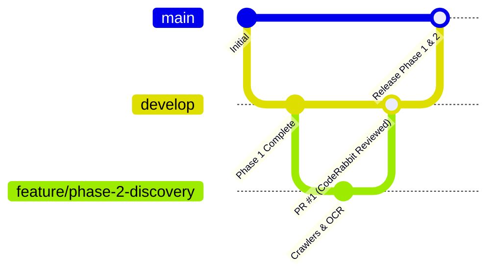

# Git Branching Strategy & Workflow Guide

This repository follows a structured **Git Flow / Feature Branch** workflow with automated **CodeRabbit AI Reviews** and **GitHub Actions CI**.

---

## 1. Branch Hierarchy



- **`main`**: Production & release branch. Always deployable and protected.
- **`develop`**: Central integration branch. All completed features are merged here.
- **`feature/<name>`**: Temporary working branches created off `develop` for specific phases or features.

---

## 2. Daily Workflow for Features

### Step 1: Start a New Feature (e.g. Phase 2)
Always branch off the latest `develop`:
```bash
git checkout develop
git pull origin develop
git checkout -b feature/phase-2-discovery
```

### Step 2: Make Changes & Commit
Commit frequently with clear semantic commit prefixes (`feat:`, `fix:`, `test:`, `docs:`, `refactor:`):
```bash
git add .
git commit -m "feat: implement EPADS scraper connector and PDF OCR extractor"
```

### Step 3: Push and Open a Pull Request
Push your feature branch to GitHub:
```bash
git push -u origin feature/phase-2-discovery
```
Open a Pull Request on GitHub:
- **Base branch:** `develop`
- **Compare branch:** `feature/phase-2-discovery`

---

## 3. Automated CodeRabbit & CI Checks

Once your Pull Request is opened:
1. **GitHub Actions CI** automatically runs:
   - `api-tests`: Executes backend Pytest suite.
   - `web-tests`: Runs Next.js ESLint and production build.
2. **CodeRabbit AI Reviewer**:
   - Analyzes your code changes against `.coderabbit.yaml`.
   - Strictly enforces domain rules from `AGENTS.md` (e.g. 4 distinct indicators, no fake dates, deterministic decimal arithmetic, expired evidence handling).
   - Generates high-level summaries and actionable feedback.

---

## 4. Merging into Develop & Releasing to Main

1. **Merge Feature → Develop:**
   - Once CI passes and CodeRabbit review is approved, merge the PR into `develop`.
2. **Release Develop → Main:**
   - At the end of major milestones, open a PR from `develop` into `main` for release.
